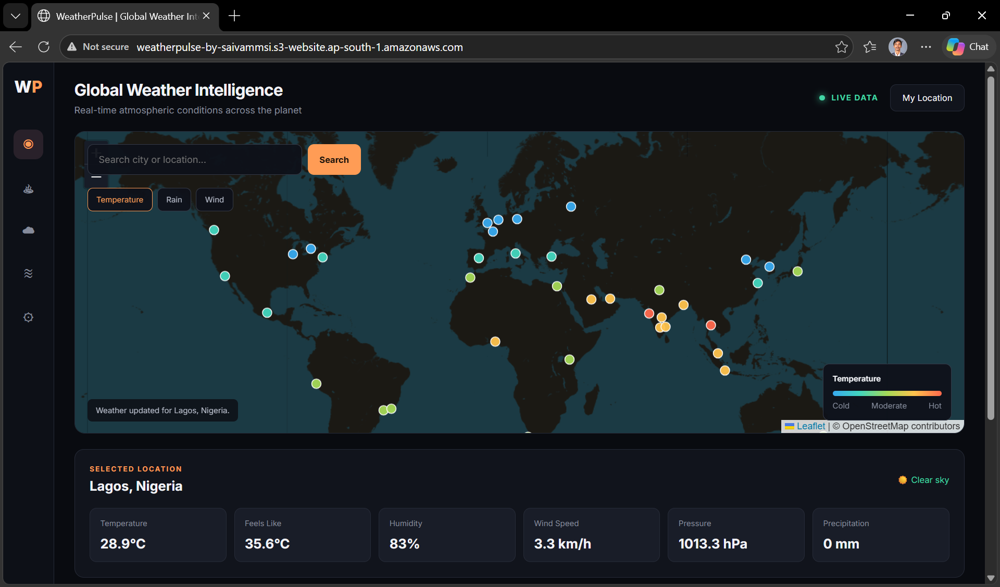
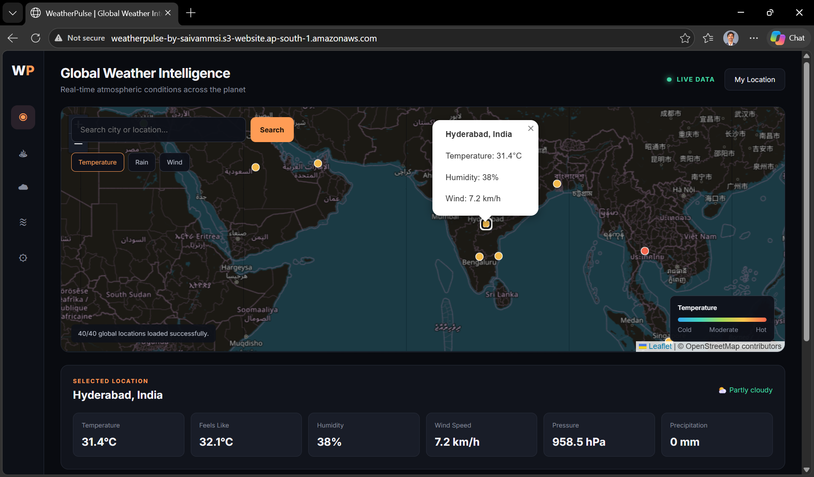
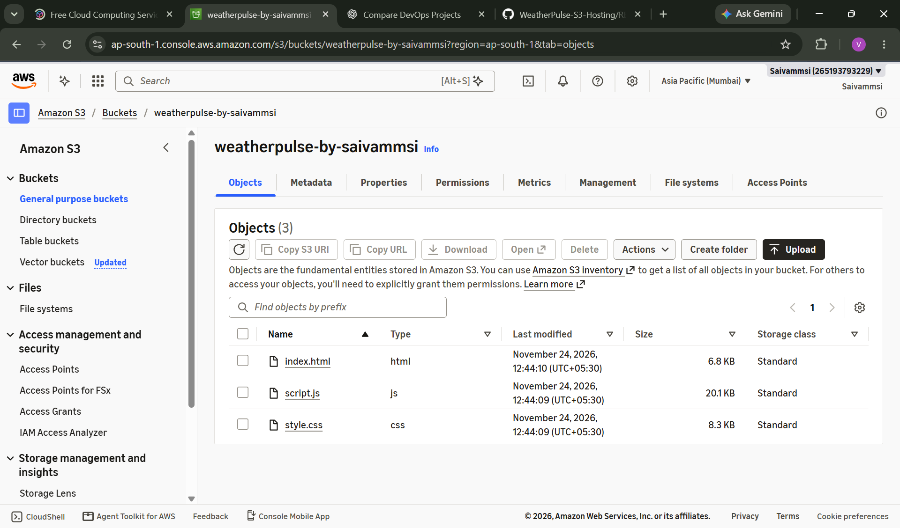
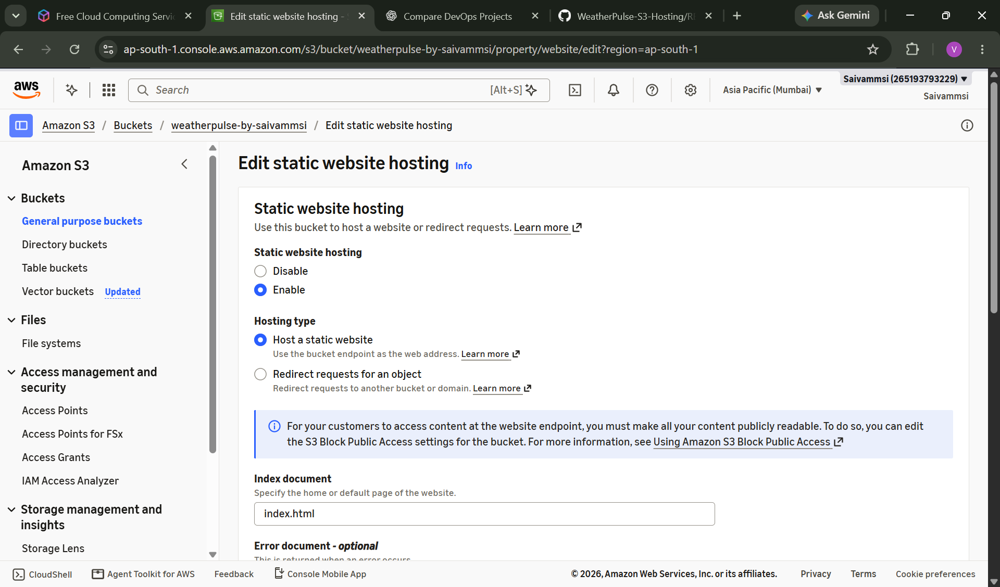
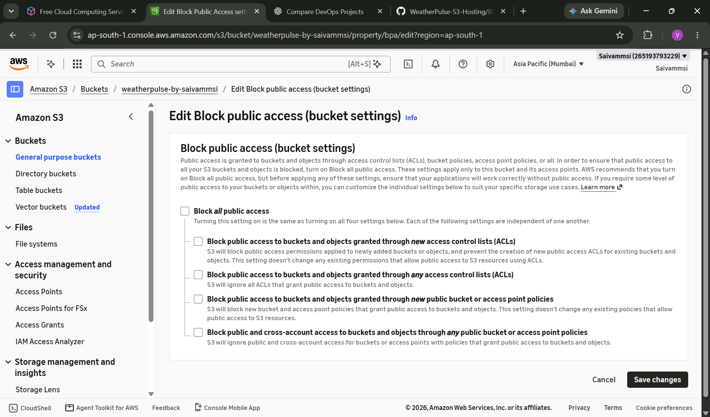

## WeatherPulse — Global Weather Dashboard

WeatherPulse is a responsive global weather dashboard built using HTML, CSS and JavaScript. It provides current weather information and a 7-day forecast for cities worldwide through an interactive map.

The application uses the Open-Meteo API for weather data and Leaflet with OpenStreetMap for geographical visualization. It is deployed as a static website using Amazon S3.

## Features

- Interactive global map using Leaflet and OpenStreetMap
- Weather monitoring across 40 predefined global cities
- Current temperature and feels-like temperature
- Humidity, wind speed, atmospheric pressure and precipitation information
- 7-day weather forecast
- Search for cities worldwide
- Browser-based geolocation
- Temperature, rain and wind visualization modes
- Responsive dashboard layout
- API error handling and request timeouts

## Technologies Used

| Technology | Purpose |
|---|---|
| HTML5 | Website structure |
| CSS3 | Styling and responsive design |
| JavaScript | Application functionality |
| Leaflet.js | Interactive map library |
| OpenStreetMap | Map tiles and geographical data |
| Open-Meteo API | Weather data |
| Open-Meteo Geocoding API | City search |
| Amazon S3 | Static website hosting |
| AWS IAM | Access management |
| Git and GitHub | Version control and source code hosting |

## Project Structure

```text
WeatherPulse/
│
├── src/
│   ├── index.html
│   ├── style.css
│   └── script.js
│
├── screenshots/
│   ├── city-weather.png
│   ├── forecast.png
│   ├── global-map.png
│   ├── s3-Objects.png
│   ├── s3-static-hosting-config.png
│   └── s3-static-hosting-config2.png
│
├── README.md
└── .gitignore
```

## Application Screenshots

### 1. Global Weather Dashboard



### 2. City Weather Information



### 3. Seven-Day Weather Forecast


## Run Locally

### 1. Clone the repository

```bash
git clone https://github.com/SaivammsiBara/WeatherPulse-S3-Hosting.git
```

### 2. Navigate to the project directory

```bash
cd WeatherPulse-S3-Hosting
```

### 3. Navigate to the source directory

```bash
cd src
```

### 4. Start a local HTTP server

```bash
python3 -m http.server 8000
```

### 5. Open the application

Visit:

http://localhost:8000

Press `Ctrl + C` to stop the local server.

## AWS Deployment — Amazon S3 Static Website Hosting

WeatherPulse is deployed using Amazon S3 Static Website Hosting.

### Deployment Architecture

```text
User Browser
     |
     v
Amazon S3 Static Website Endpoint
     |
     v
    index.html
     |
     +---- style.css
     |
     +---- script.js
     |
     +---- Open-Meteo API
     |
     +---- OpenStreetMap
```

### Deployment Steps

**1. Create an S3 bucket**

- Open the AWS Management Console.
- Navigate to Amazon S3.
- Create a bucket with a globally unique name.
- Select the required AWS Region.

**2. Upload website files**

The application files are stored inside the `src/` directory.

Upload these three files directly into the root of the S3 bucket:

- `index.html`
- `style.css`
- `script.js`

Do not upload the entire `src/` folder. The files must be at the bucket root so the website endpoint can locate the index document and its associated assets.

**3. Enable static website hosting**

- Open the bucket's Properties tab.
- Navigate to Static website hosting.
- Enable static website hosting.
- Select Host a static website.
- Set the index document to `index.html`.
- Save the configuration.

**4. Configure public access**

For direct public S3 website hosting:

- Review Block Public Access settings.
- Configure the required public access settings.
- Apply a bucket policy allowing `s3:GetObject` for website objects.

Only intended website files should be publicly accessible. Never store credentials or private information in the public bucket.

**5. Access the deployed website**

- Navigate to Properties → Static website hosting.
- Copy the Bucket website endpoint.
- Open the endpoint in a browser.
- Verify that the dashboard and its assets load correctly.

### AWS Deployment Screenshots

**S3 Bucket Objects**



**S3 Static Website Hosting Configuration**



**Additional Hosting Configuration**



### AWS Services Used

| AWS Service | Purpose |
|---|---|
| Amazon S3 | Static website hosting |
| AWS IAM | Access management |
| S3 Bucket Policy | Public read access for website objects |

## Data Sources and Attribution

- Weather data: [Open-Meteo](https://open-meteo.com/)
- Map library: [Leaflet](https://leafletjs.com/)
- Map data: [OpenStreetMap](https://www.openstreetmap.org/copyright)

## Limitations

- The application depends on external weather and geocoding APIs.
- Direct S3 static website endpoints use HTTP rather than HTTPS.
- Browser geolocation requires a secure context, such as HTTPS.
- Rain and wind visualization modes change marker presentation; they are not live meteorological radar overlays.
- The application does not currently have a backend, database or user authentication system.

## Future Improvements

- HTTPS support using Amazon CloudFront
- Automated deployment using GitHub Actions
- Infrastructure provisioning using Terraform
- Monitoring and alerting using Amazon CloudWatch

## Author

**Saivammsi Bara**

GitHub: [SaivammsiBara](https://github.com/SaivammsiBara)

Repository: [WeatherPulse — S3 Hosting](https://github.com/SaivammsiBara/WeatherPulse-S3-Hosting)
